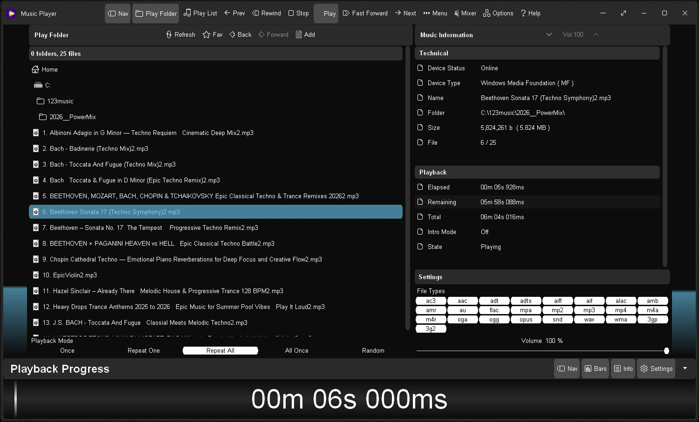
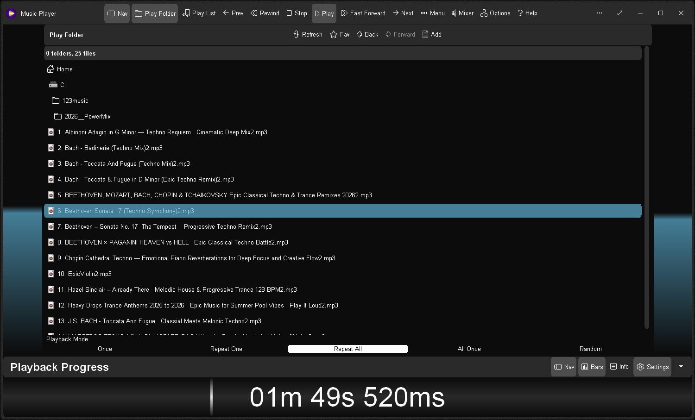
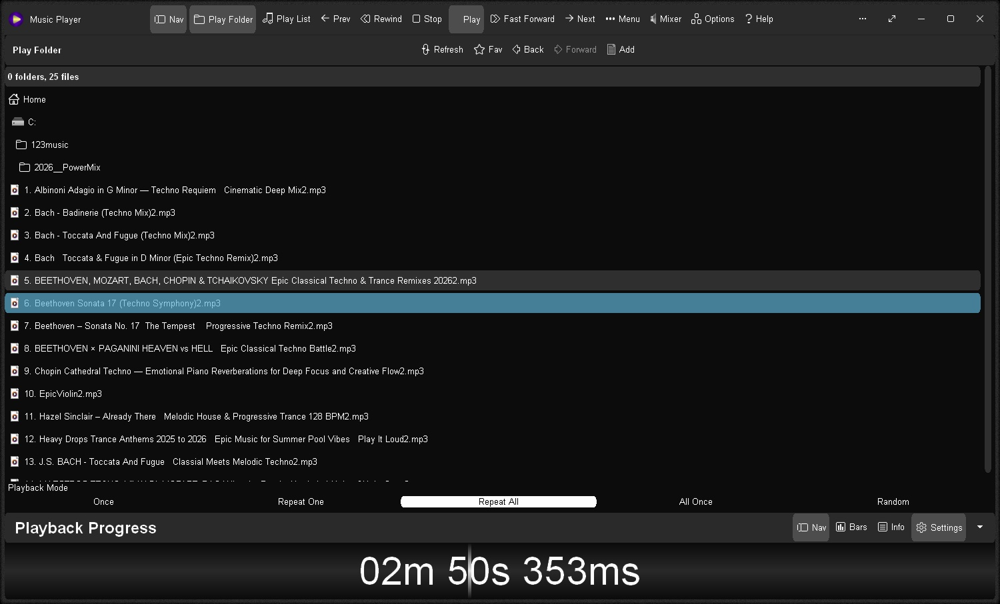
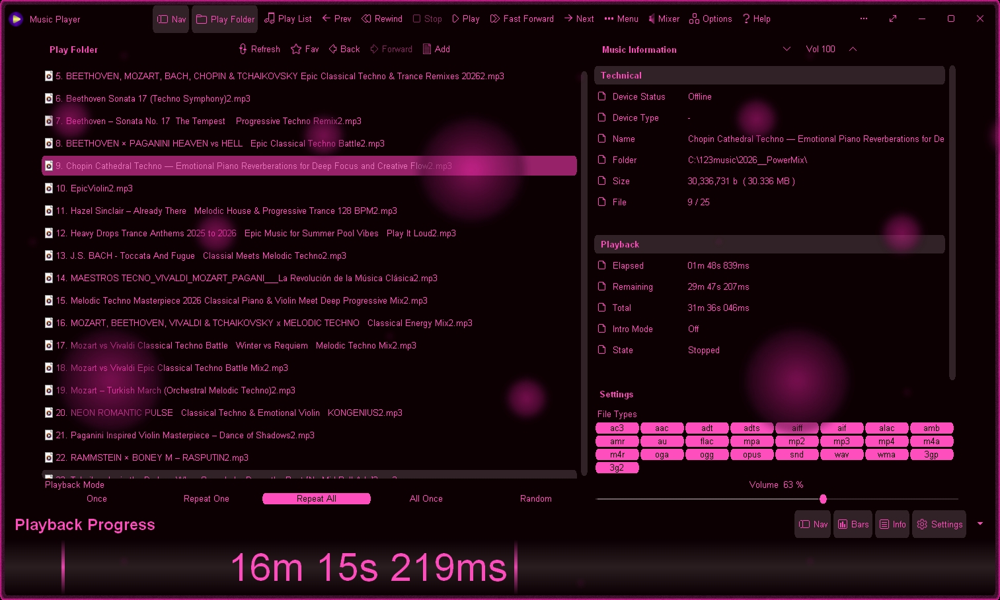
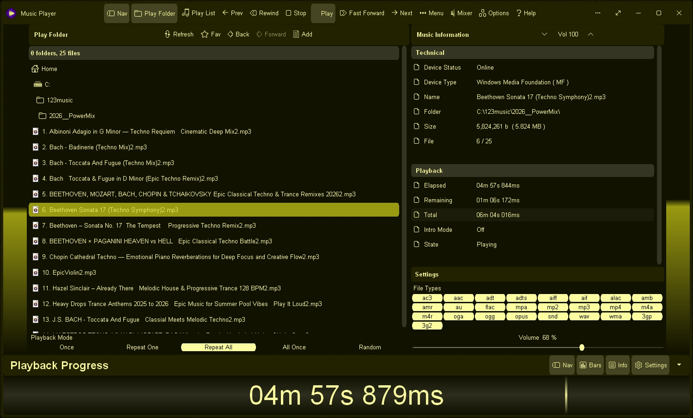

# Music Player v1.0.970 / 22nov2026 / MIT License
Play offline music files from a folder or playlist.  A large playback progress bar enables jumping forward and backward with just a single click or tap.

# Features
* Dual play systems - Play Folder / Play List
* Dual audio systems - Windows Media Foundation (MF) and Multimedia Control Interface (MCI) 
* Supported audio formats: ac3, aac, adt, adts, aif, aiff, alac, amb, amr, au, flac, mpa, mp2, mp3, mp4, m4a, m4r, oga, ogg, opus, snd, wav, wma, 3gp, and 3g2 (modern formats require Win10/11)
* Elapsed, Remaining and Total time readouts
* Information panel
* Native ".m3u" playlist support (copy, paste, open, save, build)
* Drag and drop audio files to play/add to playlist
* Play Modes: Once, Repeat One, Repeat All, All Once, Random
* Intro Mode: Play first 2s, 5s, 10s or 30s of midi
* Rewind/Fast Forward by: 1s, 2s, 5s, 10s or 30s
* Play on Start option - playback commences on app start
* Playback Progress bar - click to reposition/jump backward or forward in time
* Peak Volume Bars (left/right)
* Volume control
* Large list capacity for handling thousands of audio files
* Simple and easy to use
* Options Window - Easily change app color, font, and settings
* Portable
* Smart Source Code (Borland Delphi 3 and Lazarus 2.2/4.4/4.6)

# Codebase Changes
* Optimised for 2K display @ 60fps+
* Source code supports both 32-bit and 64-bit
* 32-bit compilation in Borland Delphi 3 (stable)
* 32-bit compilation in Lazarus 2.2 (stable)
* 64-bit compilation in Lazarus 4.4 (stable)
* 64-bit compilation in Lazarus 4.6 (stable)

